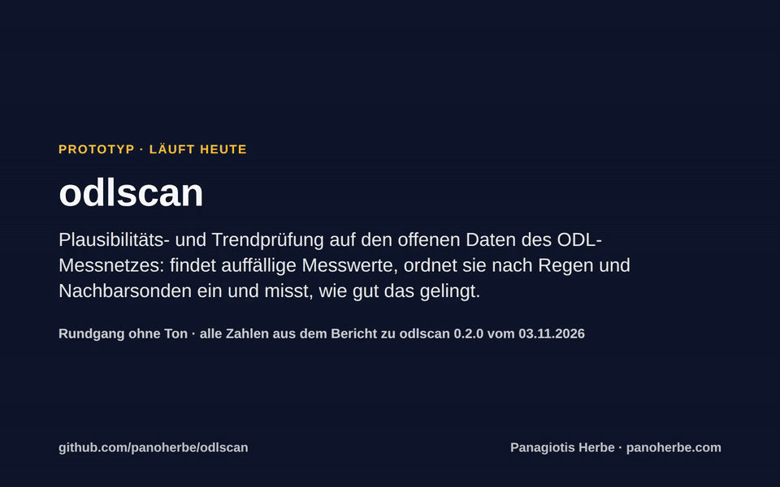
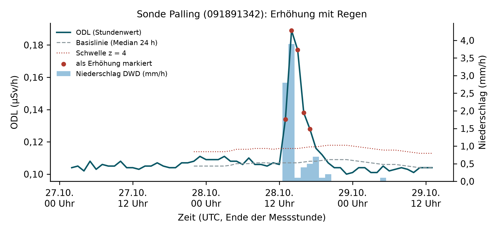
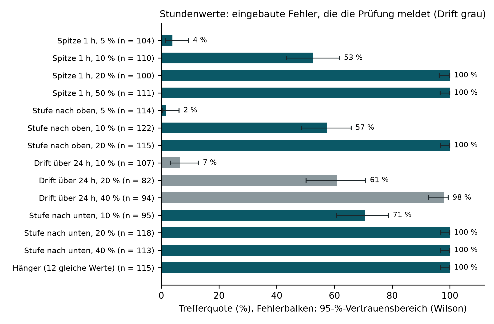
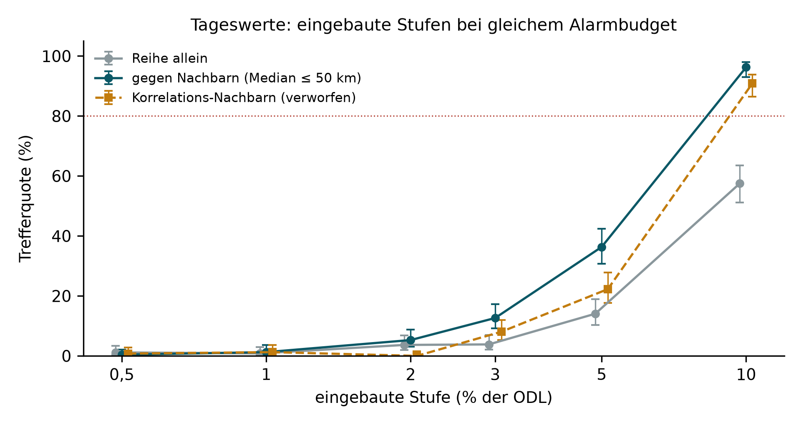
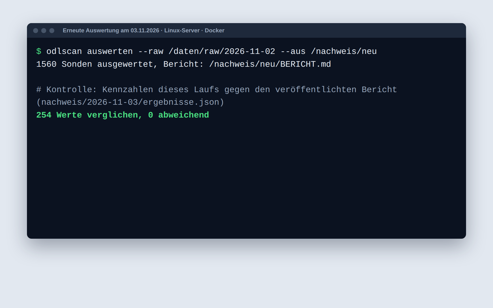

# odlscan

**Prüft die offenen Messdaten des ODL-Messnetzes automatisch auf Auffälligkeiten, ordnet sie nach Regen und
Nachbarsonden ein und misst, wie zuverlässig das gelingt. Das läuft heute, auf den echten Daten aller 1.560 Sonden.**



<sub>Rundgang, 69 Sekunden, ohne Ton, mit Untertiteln. Alle Zahlen stammen aus dem Bericht zu odlscan 0.2.0 vom
03.11.2026; die Auswertung im Terminal ist ein erneuter Lauf am 03.11.2026 auf derselben Rohablage.
[Video herunterladen (MP4, 1,0 MB)](https://github.com/panoherbe/odlscan/raw/main/medien/rundgang.mp4) · Text des
Rundgangs weiter unten.</sub>

## Was Sie brauchen → läuft hier schon

| Was Sie brauchen | läuft hier schon (Bericht 0.2.0, Rohablage vom 02.11.2026) |
|---|---|
| Das ganze Messnetz, echte Daten | 1.560 Sonden in Betrieb; 554.712 Tageswerte (02.11.2025 bis 01.11.2026) und 261.210 Stundenwerte (26.10. bis 02.11.2026), dazu Niederschlag und Schneehöhe des DWD |
| Eine nachvollziehbare Datenbasis | 5.295 Abrufe bei BfS und DWD, jede Antwort unverändert abgelegt, mit URL, SHA-256 und Abrufzeit; ausgewertet wird nur aus der Ablage |
| Auffällige Stundenwerte finden | Erhöhung, Absenkung und Hänger gegen die Basislinie der letzten 24 Stunden; eingebaute Spitzen, Stufen und Absenkungen von 20 % der ODL zu 100 % gefunden, von 10 % zu 53 % bis 71 %, Hänger zu 100 %; eine Drift von 10 % über 24 h nur zu 7 % |
| Regen von echten Auffälligkeiten trennen | 842 von 875 Erhöhungen, für die der nächste Regenmesser Werte hat, fallen mit Regen zusammen (96 %); wo Messerdaten fehlen, steht das dabei |
| Voralarme einordnen | Regel nachgebildet (zwei Sonden unter 30 km innerhalb einer Stunde erhöht): 25 Ereignisse in sieben Tagen; 13 mit Regen, 3 gemessen trocken, 9 ohne Messerdaten |
| Sprungstellen in Tagesreihen finden | gegen den Median der Nachbarsonden: eingebaute Stufe von 10 % zu 96 % gefunden (Reihe allein 57 %), von 5 % zu 36 % (14 %), bei gleichem Alarmbudget |
| Einflüsse wie Schnee kennen | bei 16–30 cm Schnee im Median 7,0 % niedrigere Tages-ODL (1.866 Sonden-Tage an 462 Sonden), bei mehr als 30 cm 11,6 % (156 Sonden-Tage an 52 Sonden) |
| Güte gemessen statt behauptet | künstliche Fehler in echte Reihen eingebaut und wiedergefunden, mit 95-%-Vertrauensbereich; Präzision der Meldungen an Prüfende 61 % bis 64 % |
| Reproduzierbare Ergebnisse | am 03.11.2026 erneut ausgewertet: alle 254 Werte der Ergebnisdatei identisch mit dem Bericht ([Kontrolllauf](nachweis/2026-11-03/kontrolllauf.txt)); Auswertung aller Sonden in 31 s (Summe der gemessenen Schritte) |
| Getestet unter Linux und Windows | 16 Tests grün unter Windows und Ubuntu, Python 3.11 bis 3.13 ([GitHub Actions, Lauf vom 03.11.2026](https://github.com/panoherbe/odlscan/actions/runs/41701987286)) |
| Offen und weiterverwendbar | AGPL-3.0, mit GPL v3 kombinierbar; reines Python mit NumPy und Matplotlib |

Messweg, Verfahren und alle Tabellen: [Bericht zu odlscan 0.2.0](nachweis/2026-11-03/BERICHT.md)
([als PDF mit Testprotokoll](https://github.com/panoherbe/odlscan/raw/main/nachweis/2026-11-03/BERICHT.pdf), 10 Seiten) und
[Testprotokoll](nachweis/2026-11-03/PROTOKOLL.md). Was gegenüber der ersten Fassung vom 02.11.2026 korrigiert
wurde, steht offen in Abschnitt 8 des Berichts.

## In zwei Minuten selbst prüfen

1. **Den Bericht lesen:** [im Browser](nachweis/2026-11-03/BERICHT.md) – ganz oben steht alles Wichtige auf einen
   Blick – oder [als PDF mit Testprotokoll herunterladen](https://github.com/panoherbe/odlscan/raw/main/nachweis/2026-11-03/BERICHT.pdf)
   (10 Seiten).
2. **Die Tests ansehen:** der [Lauf unter Windows und Ubuntu](https://github.com/panoherbe/odlscan/actions/runs/41701987286)
   vom 03.11.2026, sechs Jobs, je 16 Tests.
3. **Selbst auswerten**, mit Python 3.11 oder neuer:
   ```bash
   git clone https://github.com/panoherbe/odlscan.git
   cd odlscan
   pip install ".[plots]"
   odlscan holen --daten daten
   odlscan auswerten --raw daten/raw/<Abrufdatum> --aus nachweis/<Datum>
   ```
   `holen` lädt die aktuellen offenen Daten neu (am 02.11.2026: 5.295 Abrufe); die Zahlen gelten dann für den neuen
   Zeitraum.

## Ihr Vorteil: Sie bewerten Ergebnisse, keine Ankündigung

- **Sie sehen vorab, wie die Verfahren auf den echten Daten arbeiten** – mit Zahlen zu allen 1.560 Sonden, nicht
  mit Folien.
- **Die Messmethode steht schon:** künstliche Fehler einbauen, wiederfinden, Trefferquote und Präzision mit
  Vertrauensbereich. Mit demselben Maßstab lässt sich jedes weitere Verfahren prüfen und vergleichen.
- **Auch die negativen Befunde sind dokumentiert:** Eine schleichende Drift findet die einfache Prüfung kaum, das
  Abklingen nach Regen trennt mit Stundenwerten wenig, eine Nachbarauswahl nach Korrelation ist schlechter und
  verworfen. Das spart Projektzeit.
- **Offen und anschlussfähig:** AGPL-3.0 und mit GPL-v3-Software kombinierbar (Abschnitt 13 beider Lizenzen); im
  Auftrag gilt die vertraglich vereinbarte Lizenz.

## So sieht es aus

<table>
<tr>
<td width="50%" valign="top"><br><sub>Abb. 2 des Berichts: eine Erhöhung durch Regen. Erst der Niederschlag macht aus „auffällig, prüfen“ ein „regenbedingt“.</sub></td>
<td width="50%" valign="top"><br><sub>Abb. 3: Trefferquote für eingebaute Fehler. Sprünge ab 20 % findet schon die einfache Prüfung sicher, eine schleichende Drift von 10 % kaum.</sub></td>
</tr>
<tr>
<td valign="top"><br><sub>Abb. 4: Sprungstellen in Tagesreihen. Der Vergleich gegen Nachbarsonden findet eine Stufe von 10 % zu 96 %, die Reihe allein zu 57 %.</sub></td>
<td valign="top"><br><sub>Erneute Auswertung am 03.11.2026 auf derselben Rohablage: alle 254 Werte der Ergebnisdatei wie im veröffentlichten Bericht.</sub></td>
</tr>
</table>

<details>
<summary><b>Text des Rundgangs</b> (die Untertitel des Videos)</summary>

| ab | Untertitel |
|---|---|
| 0:00 | **Titel:** odlscan – Plausibilitäts- und Trendprüfung auf den offenen Daten des ODL-Messnetzes: findet auffällige Messwerte, ordnet sie nach Regen und Nachbarsonden ein und misst, wie gut das gelingt. |
| 0:04 | **Ausgewertet wird das ganze Messnetz:** 1.560 Sonden in Betrieb · 554.712 Tageswerte (02.11.2025 bis 01.11.2026) · 261.210 Stundenwerte (26.10. bis 02.11.2026), dazu Niederschlag und Schnee des DWD · 5.295 Abrufe, jede Antwort unverändert mit SHA-256 abgelegt; ausgewertet wird nur aus der Ablage. |
| 0:10 | Ein Befehl wertet alle Sonden aus der unveränderten Rohablage aus. |
| 0:14 | Heute zur Kontrolle neu ausgewertet: Alle 254 Werte der Ergebnisdatei stimmen mit dem veröffentlichten Bericht überein. Jede Zahl ist aus den Rohdaten reproduzierbar. |
| 0:18 | **Der Bericht (10 Seiten mit Testprotokoll):** Kennzahlen, Abbildungen, Testprotokoll. Was gegenüber der Vorfassung korrigiert wurde, steht offen in Abschnitt 8. |
| 0:22 | **Abbildung 1:** Das Grundniveau der Sonden unterscheidet sich um mehr als das Vierfache. Jede Prüfung misst deshalb gegen die eigene Basislinie der Sonde. |
| 0:27 | **Abbildung 2:** Regen hebt die Messwerte an. Mit dem Niederschlag des DWD wird daraus „regenbedingt“ statt „prüfen“: 842 von 875 Erhöhungen mit Messerdaten fallen mit Regen zusammen. |
| 0:32 | **Abbildung 3:** Fehler in echte Reihen eingebaut und wiedergefunden: Sprünge ab 20 % sicher (100 %), eine schleichende Drift von 10 % kaum (7 %). Dafür braucht es Nachbarsonden und Wetter als Erwartungswert. |
| 0:38 | **25 Voralarme in sieben Tagen, eingeordnet:** 13 mit Regen an der Mehrheit der beteiligten Sonden · 3 gemessen trocken, Kandidaten für eine genauere Prüfung · 9 ohne Messerdaten, Regen weder belegt noch ausgeschlossen · Folgerung: Niederschlag aus dem Radar würde beide Lücken schließen, Entfernung und Datenende. |
| 0:43 | **Abbildung 4:** Gegen den Median der Nachbarsonden wird eine Stufe von 10 % zu 96 % gefunden, in der Reihe allein zu 57 %. Stufen von 5 % und weniger bleiben mit einem Jahr Daten meist unentdeckt. |
| 0:49 | **Abbildung 5:** Bei mehr als 30 cm Schnee liegt die Tages-ODL im Median um 11,6 % niedriger – passend zur Abschirmung der Bodenstrahlung; gezeigt ist ein Zusammenhang, kein Ursachennachweis. |
| 0:54 | **Geprüft am 03.11.2026:** 16 Tests grün unter Windows und Linux, Python 3.11 bis 3.13 (GitHub Actions) · 254 von 254 Werten der Ergebnisdatei bei erneuter Auswertung identisch · 1.560 Sonden in einem Lauf, nur aus der unveränderten Rohablage · AGPL-3.0, mit GPL v3 kombinierbar. |
| 0:59 | **Was die offenen Daten nicht hergeben:** ein Jahr Tageswerte, keine Aussage zu langfristigen Trends · sieben Tage Stundenwerte, keine 10-Minuten-Werte · die echten Plausibilisierungsentscheidungen sind nicht öffentlich, die Trefferquoten gelten für eingebaute Fehler · bis 20 km zum nächsten Regenmesser, kein Radarniederschlag. |
| 1:04 | **Selbst prüfen:** Code, Bericht, Testprotokoll und Abrufliste liegen offen. Zwei Befehle holen die Daten und werten sie aus. AGPL-3.0. |

</details>

## Ehrlich gesagt: Was der Prototyp noch nicht ist

Ein Prototyp auf den offenen Daten, gebaut, um Verfahren und Messmethode zu zeigen. Er macht keine abschließenden
Aussagen zur radiologischen Lage.

| Heute noch nicht möglich oder enthalten | Was ein Auftrag ergänzen würde |
|---|---|
| Lange Reihen: Die öffentliche Schnittstelle liefert ein Jahr Tageswerte und sieben Tage Stundenwerte, keine 10-Minuten-Werte | Auswertung der vollständigen Messhistorie und der 10-Minuten-Werte |
| Echte Plausibilisierungsentscheidungen sind nicht öffentlich; die Trefferquoten gelten für eingebaute Fehler, die Präzision ist eine Untergrenze | Messung gegen echte Entscheidungen und Fehlerbilder |
| Niederschlag nur von Punktmessungen bis 20 km Entfernung; die Stationsreihe endet früher als die ODL-Reihe | flächendeckender Niederschlag aus dem Radar |
| Lernende Verfahren für Drift und Erwartungswerte | weitere Verfahren, mit derselben Messmethode bewertet |
| Dienste, Schnittstellen und Oberfläche für den Betrieb | nach Ihren Anforderungen, mit Tests unter Linux und Windows |

## Lizenz

Ab 04.11.2026 AGPL-3.0. Frühere Stände bis Commit [`62c1223`](https://github.com/panoherbe/odlscan/tree/62c1223) bleiben unter Apache-2.0. Auftraggeber erhalten im Auftrag die vertraglich vereinbarte Lizenz. Berichte vor dem 04.11.2026 nennen noch Apache-2.0.

## Kontakt

Panagiotis Herbe · [panoherbe.com](https://panoherbe.com)

---

## Für Ihre IT: Technik im Detail

*Prototype for trend and plausibility analysis of the open gamma dose rate data of Germany's Federal Office for
Radiation Protection (BfS). Documentation in German.*

Reines Python (NumPy, Matplotlib für Abbildungen), getestet unter Linux und Windows. Lizenz AGPL-3.0 (bis Commit
`62c1223` Apache-2.0); mit GPL v3 kombinierbar (Abschnitt 13 beider Lizenzen).

### Was er kann

- **Rohdaten holen und unverändert ablegen:** Messstellenliste, Tageswerte (ein Jahr) und Stundenwerte (sieben
  Tage) aller Sonden in Betrieb über den WFS des BfS; DWD-Niederschlag (stündlich) und Schneehöhe (täglich) der
  nächsten Station im Umkreis von 20 km. Jede Antwort mit URL, SHA-256 und Abrufzeit in `manifest.jsonl`;
  ausgewertet wird nur aus der Ablage.
- **Plausibilitätsprüfung der Stundenwerte:** kausale Basislinie (Median 24 h), robuste Streuung, Erhöhung,
  Absenkung, Hänger; Einordnung einer Erhöhung als Regen (DWD-Messer), regional (Nachbarsonden) oder lokal
  (technisch prüfen), mit Angabe, ob der Regenmesser im Fenster überhaupt Werte hat; Abklingverhältnis an der
  Spitze (Radon-Folgeprodukte: nach einer Stunde rund 43 % der Erhöhung übrig, nach zwei Stunden rund 12 %,
  Bateman-Rechnung im Bericht).
- **Voralarm-Regel nachgebildet:** zwei Sonden unter 30 km innerhalb einer Stunde erhöht; eingeordnet nach Regen,
  gemessen trocken oder ohne Messerdaten.
- **Sprungstellen in Tageswerten:** binäre Segmentierung auf log(ODL), einmal auf der Reihe allein, einmal gegen
  den Median der Nachbarsonden (Homogenisierung), zum Vergleich gegen die am stärksten korrelierten Nachbarn;
  Schneetage ausgeblendet.
- **Schnee-Effekt:** Abweichung der Tages-ODL an Schneetagen gegenüber schneefreien Tagen derselben Sonde.
- **Güte gemessen statt behauptet:** künstliche Fehler (Spitze, Stufe, Drift, Absenkung, Hänger; Stufen 0,5–10 %
  in Tageswerten) in echte Reihen einbauen und wiederfinden: Trefferquote, Einordnung, Präzision.
- **Bericht:** `ergebnisse.json`, `BERICHT.md`, Abbildungen, Ereignis- und Kandidatenlisten als CSV.

### Start

```bash
pip install ".[plots]"
odlscan holen --daten daten                      # am 02.11.2026: 3.121 Abrufe beim BfS, 2.174 beim DWD
odlscan auswerten --raw daten/raw/2026-11-02 --aus nachweis/2026-11-02
```

Mit Docker: `docker compose run --rm odlscan holen --daten /daten`, dann
`docker compose run --rm odlscan auswerten --raw /daten/raw/<Datum> --aus /nachweis/<Datum>`;
Tests: `docker compose run --rm test` oder `python -m pytest tests`.

### Nachweis

`nachweis/<Datum>/` enthält je Auswertung Bericht (Markdown und PDF), Kennzahlen, Abbildungen und Testprotokoll:

- `nachweis/2026-11-03/`: **aktueller Bericht** (odlscan 0.2.0), dieselbe Rohablage vom 02.11.2026, korrigierte
  Angaben und Abbildungen (Abschnitt 8 des Berichts nennt jede Korrektur); `BERICHT.pdf` enthält das Testprotokoll
  (`PROTOKOLL.md`) als Anhang;
- `nachweis/2026-11-02/`: erster Bericht (odlscan 0.1.0), unverändert aufbewahrt.

Die Tests laufen bei jedem Push in GitHub Actions unter Ubuntu und Windows (Python 3.11 bis 3.13).

### Grenzen

Die öffentliche Schnittstelle liefert ein Jahr Tageswerte und sieben Tage Stundenwerte, nicht die vollständige
Messhistorie; die echten Plausibilisierungsentscheidungen des BfS sind nicht öffentlich. Der Prototyp zeigt
Verfahren und Messmethodik, keine abschließenden Aussagen zur radiologischen Lage.

### Daten und Lizenzen

- Bundesamt für Strahlenschutz (BfS), ODL-Messnetz: Datenlizenz Deutschland – Namensnennung – 2.0
  (Datenschnittstelle: https://odlinfo.bfs.de/ODL/DE/service/datenschnittstelle/datenschnittstelle_node.html)
- Deutscher Wetterdienst (DWD), Open Data: CC BY 4.0 (https://opendata.dwd.de/climate_environment/CDC/)

Die Rohdaten sind nicht Teil des Repositorys. Code: AGPL-3.0 (`LICENSE`, `NOTICE`).

### Rundgang und Bilder

Aufgenommen am 03.11.2026 mit Playwright (Chromium). Die Auswertung im Terminal ist ein erneuter Lauf von
`odlscan auswerten` (Commit `408618d`) auf der Rohablage vom 02.11.2026, danach ein Vergleich jeder Zahl der
Ergebnisdatei mit `nachweis/2026-11-03/ergebnisse.json` (ohne Zeitstempel, Umgebung und Laufzeiten): 254 Werte,
0 abweichend. Bericht und Abbildungen sind die Dateien aus `nachweis/2026-11-03/`. Untertitel in die Seite
gezeichnet, ohne Ton. Die drei Schlusskarten wurden am 04.11.2026 nach dem Lizenzwechsel ersetzt.
