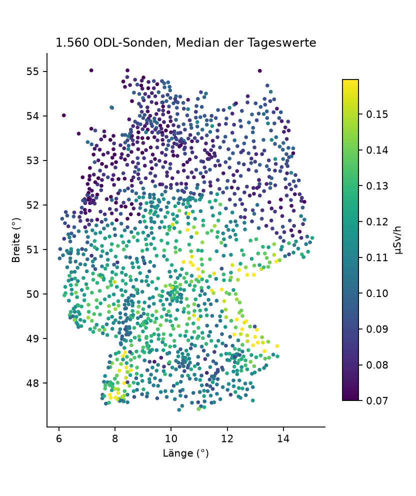
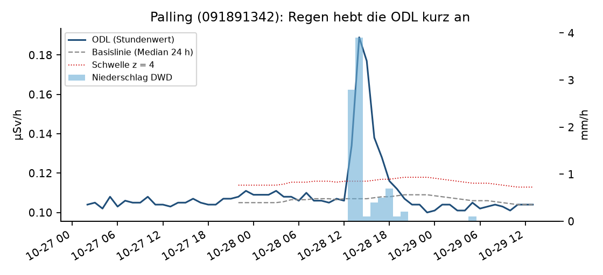
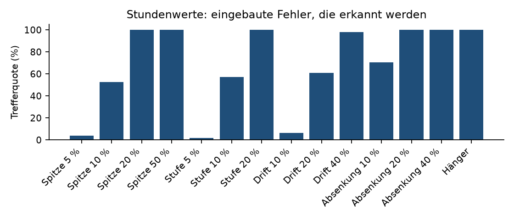
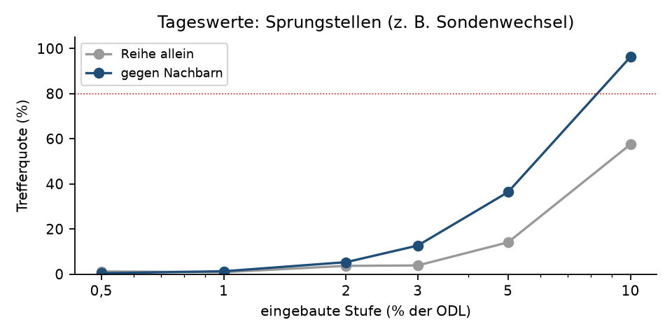
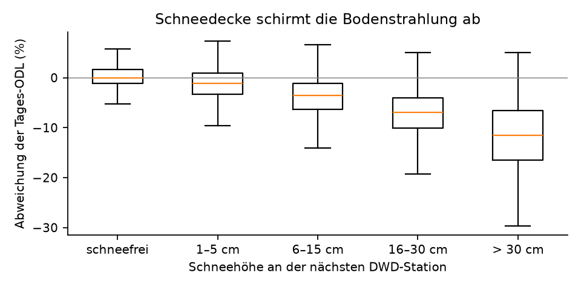

> Ersetzt durch [nachweis/2026-11-03](../2026-11-03/BERICHT.md) (0.2.0); Korrekturen dort in Abschnitt 8. Text am 04.11.2026
> nachgebessert.

# Trend- und Plausibilitätsanalyse auf offenen ODL-Daten

**Bericht zu odlscan 0.1.0** · Panagiotis Herbe · ausgewertet 02.11.2026
(UTC), Rohablage `2026-11-02`

## Auf einen Blick

- **Daten:** 1.560 ODL-Sonden des BfS in Betrieb, 554.712 Tageswerte
  (02.11.2025 bis 01.11.2026) und 261.210
  Stundenwerte (26.10.2026 bis 02.11.2026, UTC), dazu Niederschlag und Schneehöhe des DWD. Alles offen
  verfügbar, unverändert abgelegt und mit SHA-256 protokolliert.
- **Plausibilitätsprüfung (Stunden):** In echte Reihen eingebaute Fehler von 20 % der ODL (Spitze, Stufe,
  Absenkung) findet die Prüfung zu 100 %,
  von 10 % zu 53 % bis 71 %,
  Hänger zu 100 %; Präzision der Meldungen an den Prüfer
  61 % bis 64 %. Von den Erhöhungen an Sonden mit Regenmesser fallen
  96 % mit Regen zusammen und werden als „Regen“ eingeordnet.
- **Voralarm-Regel nachgebildet:** 25 Ereignisse, in denen zwei Sonden unter 30 km Abstand
  innerhalb einer Stunde erhöht sind; bei 13 davon regnet es an der Mehrheit der
  beteiligten Sonden.
- **Sprungstellen (Tage):** Bei gleichem Alarmbudget (10 % der Sonden mit
  Kandidat) findet der Vergleich gegen den Median der Nachbarsonden eine eingebaute Stufe von 10 % zu
  96 %, die Reihe allein zu 57 %;
  Stufen von 5 % und weniger bleiben mit einem Jahr Tageswerten meist unentdeckt.
- **Schnee:** Bei 16–30 cm Schneehöhe liegt die Tages-ODL im Median um
  7,0 % unter den schneefreien Tagen derselben
  Sonde, bei mehr als 30 cm um 11,6 %.

## 1 Ziel

Der Bericht zeigt an echten, öffentlich zugänglichen Messdaten des ODL-Messnetzes, wie eine automatische
Plausibilitätsprüfung und eine Trendanalyse aufgebaut, getestet und in Zahlen bewertet werden können. Er ist eine
kleine Vorstudie: Die öffentliche Schnittstelle liefert ein Jahr Tageswerte und sieben Tage Stundenwerte, nicht
die vollständige Messhistorie.

## 2 Daten

| Quelle | Inhalt | Lizenz |
|---|---|---|
| BfS, WFS `https://www.imis.bfs.de/ogc/opendata/ows`, Layer `odlinfo_sitelist`, `odlinfo_timeseries_odl_24h`, `odlinfo_timeseries_odl_1h` | Messstellen, Tages- und Stundenwerte der Gamma-ODL (µSv/h) | Datenlizenz Deutschland – Namensnennung – 2.0 |
| DWD Open Data, `climate/hourly/precipitation/recent` | Stündlicher Niederschlag R1 (mm) | CC BY 4.0 |
| DWD Open Data, `climate/daily/more_precip/recent` | Tägliche Schneehöhe SH_TAG (cm) | CC BY 4.0 |

- 1560 Sonden mit Status „in Betrieb“; Stundenwerte für 1560, Tageswerte
  für 1560. Vollständigkeit: Stunden 99,7 %, Tage
  97,4 %.
- Median der Tageswerte je Sonde: 0,106 µSv/h (5–95 %: 0,074 bis
  0,143 µSv/h; kleinster 0,044, größter 0,217 µSv/h).
- DWD-Zuordnung: nächste Station mit Datei im Umkreis von 20 km. Stündlicher Niederschlag für
  1512 Sonden, Schneehöhe für 1339 Sonden.
- Seit 01.07.2025 rechnet das BfS die ODL mit geänderter Methode (laut BfS geringe Erhöhung); der ausgewertete
  Zeitraum liegt danach.
- Jede Antwort liegt unverändert unter `raw/<Abrufdatum>/`, mit URL, SHA-256 und Abrufzeit in `manifest.jsonl`;
  ausgewertet wird nur aus diesen Dateien.



## 3 Verfahren

**Stunden (Plausibilität und Voralarme).** Basislinie je Sonde: Median der vorausgehenden 24
Stundenwerte (kausal, also im Betrieb so rechenbar). Streuung: 1,4826 × MAD der Abweichungen, mindestens
0,002 µSv/h. Markiert wird eine Erhöhung bei z ≥ 4 und mindestens 0,005 µSv/h, eine Absenkung spiegelbildlich, ein
Hänger bei sechs gleichen Werten in Folge. Eine Erhöhung heißt „regen“, wenn die nächste DWD-Station in t−2 … t+1
mindestens 0,1 mm meldet, „regional“, wenn eine Nachbarsonde (≤ 30 km) gleichzeitig z ≥ 3 zeigt, sonst „lokal“.
Die Voralarm-Regel des BfS (zwei Sonden unter 30 km innerhalb einer Stunde über Schwelle) ist mit z ≥ 4 statt der
nicht öffentlichen standortspezifischen Schwellen nachgebildet.

**Tage (Trends und Sprungstellen).** Binäre Segmentierung des Mittelwerts von log(ODL),
Mindestsegment 21 Tage, Strafterm c · σ² · ln n (σ aus den Tagesdifferenzen). Echte Tagesreihen sind
autokorreliert; mit dem üblichen c = 3 hätten 1.548 von
1.560 Sonden einen Sprung. c wird deshalb je Variante so kalibriert, dass
10 % der Sonden einen Kandidaten zeigen (Alarmbudget, Annahme): c =
856,5 für die Reihe allein, 408,1 gegen
Nachbarn. Variante „gegen Nachbarn“: log(ODL) der Sonde minus Median der
Nachbarn (≤ 50 km, Höhenunterschied ≤ 300 m, mindestens drei), wie beim Homogenisieren von Klimareihen gegen
Referenzreihen. Tage mit
Schneedecke werden ausgeblendet. Schnee-Effekt: Tageswert gegen den Median der schneefreien Tage derselben Sonde
im Fenster ± 15 Tage.

**Messung der Güte.** In echte Reihen werden künstliche Fehler eingebaut (5 Durchläufe mit
festen Zufallsstartwerten, je bis zu 300 Sonden; nur an trockenen, unauffälligen
Stellen) und wiedergefunden. Präzision: Anteil der Meldungen, die ein Prüfer ansehen müsste („lokal“, Absenkung,
Hänger) und die auf einen eingebauten Fehler fallen, mit dem echten Hintergrund aller übrigen Sonden.

## 4 Ergebnisse: Stundenwerte

223.912 bewertbare Stundenwerte (die ersten 24 Stunden je Sonde dienen der
Basislinie). Ereignisse auf den echten Daten:

| Klasse | Ereignisse | je 1.000 Stundenwerte |
|---|---|---|
| Erhöhung mit Regen | 842 | 3,76 |
| Erhöhung, regional ohne Regen am Messer | 139 | 0,62 |
| Erhöhung, lokal (technisch prüfen) | 20 | 0,09 |
| Absenkung | 24 | 0,11 |
| Hänger | 61 | 0,27 |

Abklingen nach der Spitze (Median von (x(t+1) − b) / (x(t) − b)): Regen 0,57
(n = 840), regional 0,62
(n = 135), lokal 0,63 (n = 19).
**Negativer Befund:** Mit Stundenwerten trennt das Abklingen Regen und lokale Ereignisse kaum. Die
Radon-Folgeprodukte (Halbwertszeiten 26,8 und 19,9 min) klingen innerhalb einer Stunde ab, Regen dauert aber oft
mehrere Stunden; für die Zerfallssignatur braucht es die 10-Minuten-Werte der BfS-Datenbank.



**Eingebaute Fehler:**

| Fehler | Größe | eingebaut | erkannt | richtig eingeordnet |
|---|---|---|---|---|
| Spitze (1 Stunde) | 5 % | 104 | 4 % | 100 % |
| Spitze (1 Stunde) | 10 % | 110 | 53 % | 97 % |
| Spitze (1 Stunde) | 20 % | 100 | 100 % | 100 % |
| Spitze (1 Stunde) | 50 % | 111 | 100 % | 97 % |
| Stufe nach oben | 5 % | 114 | 2 % | 50 % |
| Stufe nach oben | 10 % | 122 | 57 % | 94 % |
| Stufe nach oben | 20 % | 115 | 100 % | 97 % |
| Drift über 24 h | 10 % | 107 | 7 % | 43 % |
| Drift über 24 h | 20 % | 82 | 61 % | 88 % |
| Drift über 24 h | 40 % | 94 | 98 % | 92 % |
| Stufe nach unten | 10 % | 95 | 71 % | 100 % |
| Stufe nach unten | 20 % | 118 | 100 % | 100 % |
| Stufe nach unten | 40 % | 113 | 100 % | 100 % |
| Hänger (12 gleiche Werte) | – | 115 | 100 % | 100 % |

Präzision der Prüfer-Meldungen je Durchlauf: 62 %, 63 %, 64 %, 61 %, 62 % (eingebaut je Durchlauf
300 Fehler in 1.560 Sonden über sieben Tage). Das ist eine Untergrenze:
Auch die „anderen“ Meldungen können echte Auffälligkeiten sein.



**Voralarme (nachgebildet):** 25 Ereignisse in sieben Tagen, im Median
3 Sonden je Ereignis; 13 davon mit Regen an
der Mehrheit der beteiligten Sonden. Die übrigen 12 sind regional
(mehrere Sonden zugleich), aber der nächste Regenmesser meldet nichts: Kandidaten für Niederschlag, den eine
Punktmessung bis 20 km entfernt nicht sieht; Radardaten (DWD RADOLAN) würden das klären.

## 5 Ergebnisse: Tageswerte

Sprungkandidaten auf den echten Daten mit kalibriertem Strafterm: 157 an
156 Sonden auf der Reihe allein, 160 an
154 Sonden gegen Nachbarn (1.546 Sonden haben genug
Nachbarn; Liste in `sprungkandidaten.csv`). Kandidaten sind keine Befunde: Ob ein Sondenwechsel,
eine Standortänderung oder Bewuchs dahintersteht, zeigen erst die internen Stammdaten.

**Eingebaute Stufen (1.489 geeignete Sonden, beide Varianten mit gleichem Alarmbudget):**

| Stufe | erkannt, Reihe allein | erkannt, gegen Nachbarn |
|---|---|---|
| 0,5 % | 1 % | 0 % |
| 1,0 % | 1 % | 1 % |
| 2,0 % | 4 % | 5 % |
| 3,0 % | 4 % | 13 % |
| 5,0 % | 14 % | 36 % |
| 10,0 % | 57 % | 96 % |



**Schnee:**

| Schneehöhe | Tage | Sonden | Median Abweichung | mittlere Hälfte |
|---|---|---|---|---|
| 1–5 cm | 19.504 | 1.287 | −1,2 % | −3,3 % bis 0,9 % |
| 6–15 cm | 11.679 | 1.116 | −3,5 % | −6,3 % bis −1,1 % |
| 16–30 cm | 1.866 | 462 | −7,0 % | −10,1 % bis −4,1 % |
| > 30 cm | 156 | 52 | −11,6 % | −16,5 % bis −6,6 % |
| schneefrei | 49.849 | – | 0,0 % | −1,2 % bis 1,6 % |



## 6 Grenzen

- Ein Jahr Tageswerte erlaubt keine Aussage zu langfristigen Trends; gezeigt ist, wie groß eine Änderung sein muss,
  um gefunden zu werden, und dass der Nachbarvergleich diese Schwelle senkt.
- Das Alarmbudget von 10 % der Sonden je Jahr ist eine Annahme; die Zahl echter
  Sondenwechsel und Standortänderungen steht in den Stammdaten des BfS.
- Sieben Tage Stundenwerte sind eine Stichprobe einer Herbstwoche; Gewitterlagen, Schnee und Inversionen sind
  darin nicht oder kaum enthalten.
- Die echten Plausibilisierungsentscheidungen des BfS sind nicht öffentlich. Die Trefferquoten gelten für
  eingebaute Fehler, nicht für die realen Fehlerbilder; die Präzision ist eine Untergrenze.
- Der Regenmesser steht bis zu 20 km von der Sonde entfernt; lokale Schauer verfehlt er. Die DWD-Daten der Reihe
  `recent` sind nur eingeschränkt geprüft.

## 7 Reproduzieren

```
pip install .[plots]
odlscan holen --daten daten
odlscan auswerten --raw daten/raw/<Abrufdatum> --aus nachweis/<Datum>
```

Laufzeiten dieses Laufs: Einlesen 24 s, Stundenprüfung 0,7 s,
Stundentest 1,2 s, Tagesprüfung 2,4 s, Tagestest
0,3 s; Python 3.12.13, NumPy 2.5.4, Linux-7.0.0-31-generic-x86_64-with-glibc2.41.

Datenquellen: Bundesamt für Strahlenschutz (BfS), ODL-Messnetz, Datenlizenz Deutschland – Namensnennung – 2.0;
Deutscher Wetterdienst (DWD), Open Data, CC BY 4.0.
