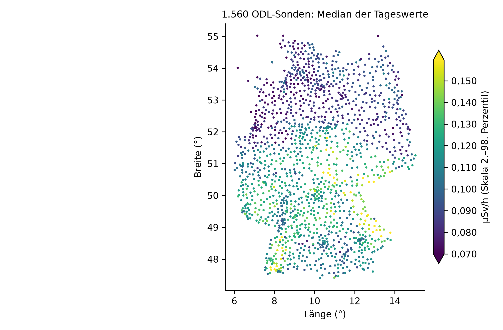
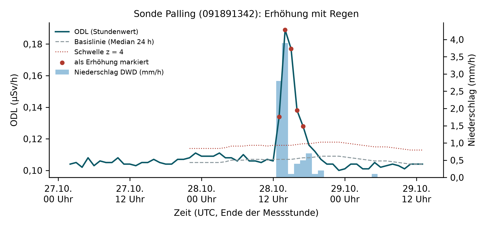
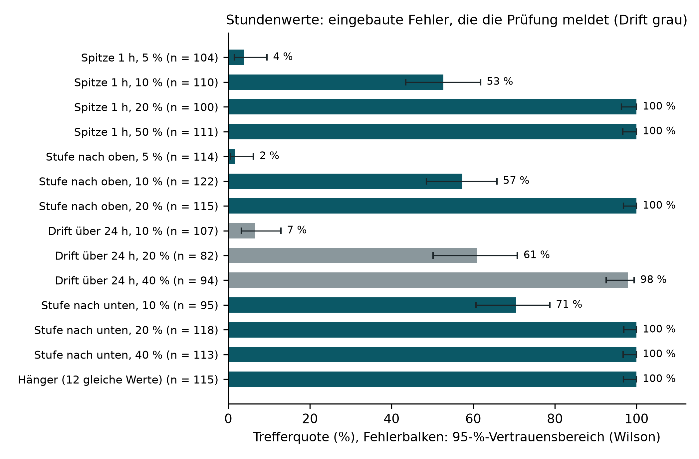
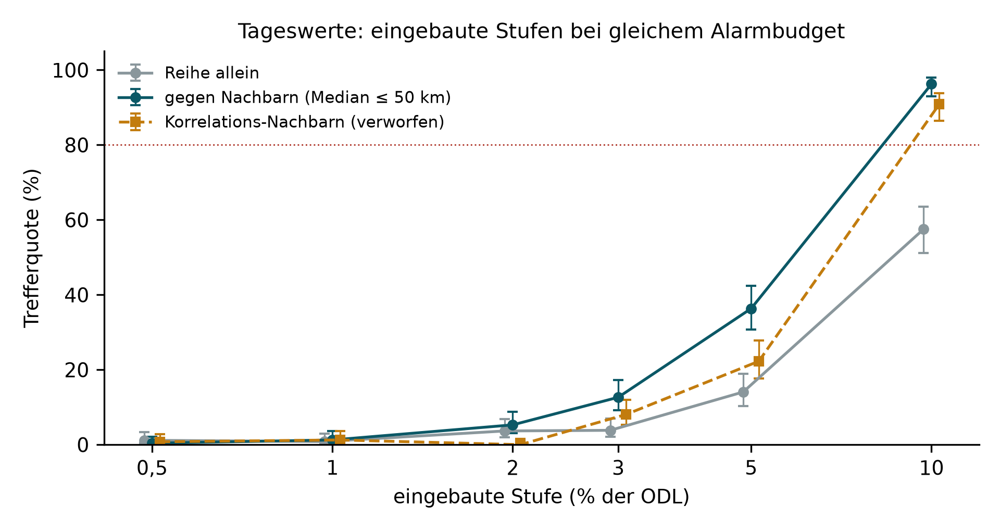
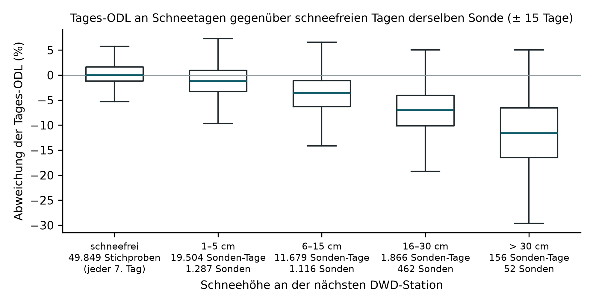

# Trend- und Plausibilitätsanalyse auf offenen ODL-Daten

**Bericht zu odlscan 0.2.0** · Panagiotis Herbe · ausgewertet 03.11.2026
(UTC), Rohablage `2026-11-02` · ersetzt den Bericht vom 02.11.2026 (odlscan 0.1.0); die Korrekturen stehen in
Abschnitt 8.

## Auf einen Blick

- **Daten:** 1.560 ODL-Sonden des BfS in Betrieb, 554.712 Tageswerte
  (02.11.2025 bis 01.11.2026) und 261.210
  Stundenwerte (26.10.2026 bis 02.11.2026, UTC), dazu Niederschlag und Schneehöhe des DWD. Alles offen
  verfügbar, unverändert abgelegt und mit SHA-256 protokolliert.
- **Plausibilitätsprüfung (Stunden):** Die einfache Prüfung (Median der letzten 24 Stunden als Basislinie, robuster
  z-Wert ≥ 4) findet in echte Reihen eingebaute Spitzen, Stufen und Absenkungen von 20 % der ODL zu
  100 %, von 10 % zu
  53 % bis 71 %. Eine Drift über
  24 Stunden findet sie schlecht: von 20 % zu 61 %, von 10 % zu 7 %. Hänger zu
  100 %. Präzision der Meldungen an den Prüfer 61 % bis 64 %. Von den
  875 Erhöhungen, für die der nächste Regenmesser Werte hat, fallen
  842 (96 %) mit Regen zusammen.
- **Voralarm-Regel nachgebildet:** 25 Ereignisse, in denen zwei Sonden unter 30 km Abstand
  innerhalb einer Stunde erhöht sind; bei 13 regnet es an der Mehrheit der beteiligten Sonden, bei
  9 fehlen an der Mehrheit Regenmesserdaten, 3 sind gemessen
  trocken.
- **Sprungstellen (Tage):** Bei gleichem Alarmbudget (10 % der Sonden mit
  Kandidat) findet der Vergleich gegen den Median der Nachbarsonden eine eingebaute Stufe von 10 % zu
  96 %, die Reihe allein zu 57 %;
  Stufen von 5 % und weniger bleiben mit einem Jahr Tageswerten meist unentdeckt.
- **Schnee:** Bei 16–30 cm Schneehöhe liegt die Tages-ODL im Median um
  7,0 % unter den schneefreien Tagen derselben Sonde
  (1.866 Sonden-Tage an 462 Sonden), bei mehr als 30 cm um
  11,6 % (156 Sonden-Tage an
  52 Sonden).

## 1 Ziel

Der Bericht zeigt an echten, öffentlich zugänglichen Messdaten des ODL-Messnetzes, wie eine automatische
Plausibilitätsprüfung und eine Trendanalyse aufgebaut, getestet und in Zahlen bewertet werden können. Er ist eine
kleine Vorstudie: Die öffentliche Schnittstelle liefert ein Jahr Tageswerte und sieben Tage Stundenwerte, nicht
die vollständige Messhistorie.

## 2 Daten

| Quelle | Inhalt | Lizenz |
|---|---|---|
| BfS, WFS `https://www.imis.bfs.de/ogc/opendata/ows`, Layer `odlinfo_sitelist`, `odlinfo_timeseries_odl_24h`, `odlinfo_timeseries_odl_1h` | Messstellen, Tages- und Stundenwerte der Gamma-ODL (µSv/h) | Datenlizenz Deutschland – Namensnennung – 2.0 |
| DWD Open Data, `climate/hourly/precipitation/recent` | Stündlicher Niederschlag R1 (mm) | CC BY 4.0 |
| DWD Open Data, `climate/daily/more_precip/recent` | Tägliche Schneehöhe SH_TAG (cm) | CC BY 4.0 |

- 1.560 Sonden mit Status „in Betrieb“; Stundenwerte für 1.560,
  Tageswerte für 1.560. Vollständigkeit: Stunden 99,7 %, Tage
  97,4 %.
- Median der Tageswerte je Sonde: 0,106 µSv/h (5–95 %: 0,074 bis
  0,143 µSv/h; kleinster 0,044, größter 0,217 µSv/h).
- DWD-Zuordnung: nächste Station mit Datei im Umkreis von 20 km. Stündlicher Niederschlag für
  1.512 Sonden, Schneehöhe für 1.339 Sonden. Die stündliche
  DWD-Reihe endet in dieser Rohablage mit der Stunde 01.11.2026, 23 UTC, die
  ODL-Stundenwerte mit 02.11.2026, 21 UTC; für die Stunden dazwischen gibt es keine Messerdaten.
- Seit 01.07.2025 verwendet das BfS bei der Berechnung der ODL einen für den Notfallschutz optimierten
  Kalibrierfaktor; die berechneten Werte liegen nach Angabe des BfS seither etwa 14–25 % höher, je nach Gegend um bis
  zu etwa 0,025 µSv/h (ODL-INFO, „Berechnung der ODL-Messwerte“, gelesen 03.11.2026). Beide ausgewerteten Zeiträume
  liegen danach.
- Abruf: 5.295 Abrufe (3.121 beim BfS, 2.174 beim DWD), 389 MB wie geliefert, 73 MB in der Ablage (JSON gzip-komprimiert, ZIP wie geliefert); 5.297 Einträge im Manifest mit den lokal berechneten Zuordnungsdateien. Jede Antwort liegt unverändert unter `raw/<Abrufdatum>/`, mit URL, SHA-256 und Abrufzeit in
  `manifest.jsonl`; ausgewertet wird nur aus diesen Dateien.

*Abb. 1: Lage der 1.560 Sonden, Farbe = Median der Tageswerte je Sonde. Die Farbskala ist auf das 2. bis 98. Perzentil begrenzt; Sonden darunter oder darüber tragen die Endfarbe (Spitzen an der Skala). Was daraus folgt: Das Niveau unterscheidet sich zwischen den Sonden um mehr als den Faktor 4 (0,044 bis 0,217 µSv/h); jede Prüfung arbeitet deshalb relativ zur eigenen Basislinie der Sonde.*

## 3 Verfahren

**Stunden (Plausibilität und Voralarme).** Basislinie je Sonde: Median der vorausgehenden 24
Stundenwerte (kausal, also im Betrieb so rechenbar). Streuung: 1,4826 × MAD der Abweichungen, mindestens
0,002 µSv/h. Markiert wird eine Erhöhung bei z ≥ 4 und mindestens 0,005 µSv/h, eine Absenkung spiegelbildlich, ein
Hänger bei sechs gleichen Werten in Folge. Eine Erhöhung heißt „regen“, wenn die nächste DWD-Station in t−2 … t+1
mindestens 0,1 mm meldet, „regional“, wenn eine Nachbarsonde (≤ 30 km) gleichzeitig z ≥ 3 zeigt, sonst „lokal“.
Mitgeschrieben wird, ob der Regenmesser im Fenster überhaupt Werte hat: Ohne Messerdaten heißt „kein Regen
gemeldet“ nicht „trocken“. Die Voralarm-Regel des BfS (zwei Sonden unter 30 km innerhalb einer Stunde über
Schwelle) ist mit z ≥ 4 statt der nicht öffentlichen standortspezifischen Schwellen nachgebildet; je Voralarm wird
gezählt, an wie vielen der beteiligten Sonden und Stunden es regnet, der Messer Werte hat oder trocken meldet.

**Tage (Trends und Sprungstellen).** Binäre Segmentierung des Mittelwerts von log(ODL),
Mindestsegment 21 Tage, Strafterm c · σ² · ln n (σ aus den Tagesdifferenzen). Echte Tagesreihen sind
autokorreliert; mit dem üblichen c = 3 hätten 1.548 von
1.560 Sonden einen Sprung. c wird deshalb je Variante so kalibriert, dass
10 % der Sonden einen Kandidaten zeigen (Alarmbudget, Annahme): c =
856,5 für die Reihe allein, 408,1 gegen
Nachbarn. Variante „gegen Nachbarn“: log(ODL) der Sonde minus Median der Nachbarn (≤ 50 km, Höhenunterschied
≤ 300 m, mindestens drei), wie beim Homogenisieren von Klimareihen gegen Referenzreihen. Vergleichsvariante
„Korrelations-Nachbarn“: Referenz aus den fünf Sonden im Umkreis von 75 km, deren Tagesänderungen am stärksten mit
denen der Sonde korrelieren (mindestens 200 gemeinsame Tage; 1.529
Sonden), Strafterm auf dasselbe Alarmbudget kalibriert. Tage mit Schneedecke werden ausgeblendet. Schnee-Effekt:
Tageswert gegen den Median der schneefreien Tage derselben Sonde im Fenster ± 15 Tage.

**Messung der Güte.** In echte Reihen werden künstliche Fehler eingebaut (5 Durchläufe mit
festen Zufallsstartwerten, je bis zu 300 Sonden; nur an trockenen, unauffälligen
Stellen mit Regenmesserdaten) und wiedergefunden. Präzision: Anteil der Meldungen, die ein Prüfer ansehen müsste
(„lokal“, Absenkung, Hänger) und die auf einen eingebauten Fehler fallen, mit dem echten Hintergrund aller übrigen
Sonden. Trefferquoten mit 95-%-Vertrauensbereich nach Wilson.

## 4 Ergebnisse: Stundenwerte

223.912 bewertbare Stundenwerte (die ersten 24 Stunden je Sonde dienen der
Basislinie). Ereignisse auf den echten Daten:

| Klasse | Ereignisse | davon mit Regenmesserdaten | je 1.000 Stundenwerte |
|---|---|---|---|
| Erhöhung mit Regen | 842 | 842 | 3,76 |
| Erhöhung, regional (kein Regen gemeldet) | 139 | 23 | 0,62 |
| Erhöhung, lokal (technisch prüfen) | 20 | 10 | 0,09 |
| Absenkung | 24 | – | 0,11 |
| Hänger | 61 | – | 0,27 |

Bei 116 der 139 regionalen und 10 der 20 lokalen
Erhöhungen hat der nächste Regenmesser im Fenster keine Werte, 81 davon am
02.11.2026 nach dem Ende der DWD-Stundenreihe. Für diese Ereignisse ist Regen weder belegt
noch ausgeschlossen. Wo der Messer Werte hat, fallen 842 von 875
Erhöhungen (96 %) mit Regen zusammen.

Abklingen nach der Spitze (Median von (x(t+1) − b) / (x(t) − b)): Regen 0,57
(n = 840), regional 0,62
(n = 135), lokal 0,63 (n = 19).
**Negativer Befund:** Mit Stundenwerten trennt das Abklingen Regen und andere Ereignisse kaum. Nach Regenende sind
von einer Erhöhung durch ausgewaschene Radon-Folgeprodukte (Pb-214, Bi-214; Halbwertszeiten 26,8 und 19,9 min) nach
einer Stunde noch rund 43 %, nach zwei Stunden rund 12 % übrig (Bateman-Rechnung, Dosisbeitrag Bi-214 zu Pb-214 etwa
85 zu 15, Annahme). Je nachdem, wann in der Stunde der Regen endet, ergibt reines Abklingen im Stundenmittel ein
Verhältnis zwischen etwa 0,35 und 0,7; hält der Regen an, liegt es höher. Die Zerfallssignatur lässt sich erst mit
den 10-Minuten-Werten der BfS-Datenbank bestimmen.

*Abb. 2: Beispiel einer Erhöhung mit Regen: das Regenereignis mit dem höchsten z-Wert in dieser Woche. Linke Achse ODL mit Basislinie und Schwelle, rote Punkte = als Erhöhung markierte Stunden; rechte Achse Niederschlag der nächsten DWD-Station. Was daraus folgt: Regen erzeugt genau die Form, die eine Schwellenprüfung auslöst; erst die Niederschlagsinformation macht daraus „regenbedingt“ statt „lokal, prüfen“.*

**Eingebaute Fehler:**

| Fehler | Größe | eingebaut | erkannt | 95-%-Bereich | richtig eingeordnet |
|---|---|---|---|---|---|
| Spitze (1 Stunde) | 5 % | 104 | 4 % | 2 % bis 9 % | 100 % |
| Spitze (1 Stunde) | 10 % | 110 | 53 % | 43 % bis 62 % | 97 % |
| Spitze (1 Stunde) | 20 % | 100 | 100 % | 96 % bis 100 % | 100 % |
| Spitze (1 Stunde) | 50 % | 111 | 100 % | 97 % bis 100 % | 97 % |
| Stufe nach oben | 5 % | 114 | 2 % | 0 % bis 6 % | 50 % |
| Stufe nach oben | 10 % | 122 | 57 % | 49 % bis 66 % | 94 % |
| Stufe nach oben | 20 % | 115 | 100 % | 97 % bis 100 % | 97 % |
| Drift über 24 h | 10 % | 107 | 7 % | 3 % bis 13 % | 43 % |
| Drift über 24 h | 20 % | 82 | 61 % | 50 % bis 71 % | 88 % |
| Drift über 24 h | 40 % | 94 | 98 % | 93 % bis 99 % | 92 % |
| Stufe nach unten | 10 % | 95 | 71 % | 61 % bis 79 % | 100 % |
| Stufe nach unten | 20 % | 118 | 100 % | 97 % bis 100 % | 100 % |
| Stufe nach unten | 40 % | 113 | 100 % | 97 % bis 100 % | 100 % |
| Hänger (12 gleiche Werte) | – | 115 | 100 % | 97 % bis 100 % | 100 % |

Präzision der Prüfer-Meldungen je Durchlauf: 62 %, 63 %, 64 %, 61 %, 62 % (eingebaut je Durchlauf
300 Fehler in 1.560 Sonden über sieben Tage). Das ist eine
Untergrenze: Auch die „anderen“ Meldungen können echte Auffälligkeiten sein.

*Abb. 3: Trefferquote je eingebautem Fehler über alle fünf Durchläufe, mit 95-%-Vertrauensbereich (Wilson); n = Zahl der eingebauten Fehler, Drift grau. Was daraus folgt: Sprunghafte Fehler ab 20 % der ODL findet schon die einfache Prüfung sicher. Eine schleichende Drift zieht die 24-Stunden-Basislinie mit und bleibt bei 10 bis 20 % meist unerkannt; dafür braucht es einen Erwartungswert aus Nachbarsonden und Wetter statt aus der eigenen Vergangenheit.*

**Voralarme (nachgebildet):** 25 Ereignisse in sieben Tagen, im Median
3 Sonden je Ereignis (Liste in `voralarme_stunden.csv`):

| Einordnung (Mehrheit der beteiligten Sonden und Stunden) | Voralarme |
|---|---|
| Regen am nächsten Messer | 13 |
| Messer hat Werte, meldet keinen Regen („trocken“) | 3 |
| teils Regen, teils trocken | 0 |
| keine Messerdaten | 9 |

Von den 12 Voralarmen ohne Regen an der Mehrheit beruhen 9 auf fehlenden
Messerdaten; nur 3 sind im Sinne gemessener Werte trocken. Diese sind Kandidaten für
Niederschlag, den eine Punktmessung bis 20 km entfernt nicht sieht, oder für andere Ursachen. Radarniederschlag
(DWD RADOLAN) liegt flächendeckend und zeitnah vor und würde beide Lücken schließen: die Entfernung zum Messer und
das Ende der Stationsreihe.

## 5 Ergebnisse: Tageswerte

Sprungkandidaten auf den echten Daten mit kalibriertem Strafterm: 157 an
156 Sonden auf der Reihe allein, 160 an
154 Sonden gegen Nachbarn (1.546 Sonden haben genug
Nachbarn; Liste in `sprungkandidaten.csv`). Kandidaten sind keine Befunde: Ob ein Sondenwechsel,
eine Standortänderung oder Bewuchs dahintersteht, zeigen erst die internen Stammdaten.

**Eingebaute Stufen (1.489 geeignete Sonden, alle Varianten mit gleichem Alarmbudget):**

| Stufe | eingebaut | erkannt, Reihe allein | erkannt, gegen Nachbarn | erkannt, Korrelations-Nachbarn |
|---|---|---|---|---|
| 0,5 % | 258 | 1 % | 0 % | 1 % |
| 1,0 % | 239 | 1 % | 1 % | 1 % |
| 2,0 % | 246 | 4 % | 5 % | 0 % |
| 3,0 % | 261 | 4 % | 13 % | 8 % |
| 5,0 % | 256 | 14 % | 36 % | 22 % |
| 10,0 % | 240 | 57 % | 96 % | 91 % |

*Abb. 4: Trefferquote für eingebaute Stufen in Tagesreihen, drei Varianten mit demselben Alarmbudget, Fehlerbalken 95 % (Wilson), Punkte zur Lesbarkeit leicht versetzt; rote Linie 80 %. Was daraus folgt: Der Vergleich gegen den Median der Nachbarn findet eine Stufe von 10 % zu 96 % statt 57 %, eine von 5 % zu 36 % statt 14 %. Die Auswahl nach Korrelation der Tagesänderungen ist schlechter (91 % und 22 %), vermutlich weil diese Änderungen von Rundung (0,001 µSv/h) und Zählrauschen geprägt sind.*

**Schnee:**

| Schneehöhe | Sonden-Tage | Sonden | Median Abweichung | mittlere Hälfte |
|---|---|---|---|---|
| 1–5 cm | 19.504 | 1.287 | −1,2 % | −3,3 % bis 0,9 % |
| 6–15 cm | 11.679 | 1.116 | −3,5 % | −6,3 % bis −1,1 % |
| 16–30 cm | 1.866 | 462 | −7,0 % | −10,1 % bis −4,1 % |
| > 30 cm | 156 | 52 | −11,6 % | −16,5 % bis −6,6 % |
| schneefrei (Vergleich, jeder 7. Tag) | 49.849 | – | 0,0 % | −1,2 % bis 1,6 % |

*Abb. 5: Abweichung der Tages-ODL an Tagen mit Schneedecke vom Median der schneefreien Tage derselben Sonde (± 15 Tage), nach Schneehöhe an der nächsten DWD-Station; Kasten = mittlere Hälfte, Linie = Median, Antennen ohne Ausreißer. Was daraus folgt: Die Abweichung wächst mit der Schneehöhe, wie es die Abschirmung der Bodenstrahlung erwarten lässt; gezeigt ist ein Zusammenhang, kein Nachweis der Ursache. Die Klasse über 30 cm beruht auf 156 Sonden-Tagen an 52 Sonden.*

## 6 Grenzen

- Ein Jahr Tageswerte erlaubt keine Aussage zu langfristigen Trends; gezeigt ist, wie groß eine Änderung sein muss,
  um gefunden zu werden, und dass der Nachbarvergleich diese Schwelle senkt.
- Das Alarmbudget von 10 % der Sonden je Jahr ist eine Annahme; die Zahl echter
  Sondenwechsel und Standortänderungen steht in den Stammdaten des BfS.
- Sieben Tage Stundenwerte sind eine Stichprobe einer Herbstwoche; Gewitterlagen, Schnee und Inversionen sind
  darin nicht oder kaum enthalten.
- Die echten Plausibilisierungsentscheidungen des BfS sind nicht öffentlich. Die Trefferquoten gelten für
  eingebaute Fehler, nicht für die realen Fehlerbilder; die Präzision ist eine Untergrenze.
- Der Regenmesser steht bis zu 20 km von der Sonde entfernt; lokale Schauer verfehlt er. Am Ende der Woche fehlen
  Messerdaten ganz (Abschnitt 2). Die DWD-Daten der Reihe `recent` sind nur eingeschränkt geprüft.

## 7 Reproduzieren

Code und Nachweis: https://github.com/panoherbe/odlscan (AGPL-3.0, bis 04.11.2026 Apache 2.0). Befehle:

    pip install ".[plots]"
    odlscan holen --daten daten
    odlscan auswerten --raw daten/raw/<Abrufdatum> --aus nachweis/<Datum>

Laufzeiten dieses Laufs: Einlesen 25 s, Stundenprüfung 0,7 s,
Stundentest 1,2 s, Tagesprüfung 3,3 s, Tagestest
0,4 s; Python 3.12.13, NumPy 2.5.4, Linux-7.0.0-31-generic-x86_64-with-glibc2.41.

Datenquellen: Bundesamt für Strahlenschutz (BfS), ODL-Messnetz, Datenlizenz Deutschland – Namensnennung – 2.0;
Deutscher Wetterdienst (DWD), Open Data, CC BY 4.0.

## 8 Korrekturen gegenüber dem Bericht vom 02.11.2026 (odlscan 0.1.0)

Verfahren, Parameter, Zufallsstartwerte und Rohablage sind unverändert; alle Kennzahlen des Berichts vom 02.11.
ergeben sich wieder genau so. Neu ausgewertet sind die Abdeckung durch Regenmesser, die Einordnung der Voralarme,
die Vergleichsvariante „Korrelations-Nachbarn“ und die Abrufstatistik; geändert sind Angaben und Darstellung.

- **Drift:** Die Zusammenfassung nannte die Trefferquoten für Spitze, Stufe und Absenkung, ohne die Drift zu
  erwähnen; sie steht jetzt getrennt da (61 % bei 20 %, 7 % bei 10 %).
- **Regenmesser-Abdeckung:** Der Bericht vom 02.11. nannte die übrigen 12 Voralarme „regional, aber der nächste
  Regenmesser meldet nichts“ und alle 139 regionalen Erhöhungen „ohne Regen am Messer“. Fehlende
  Messerdaten wurden dabei wie „kein Regen“ gezählt. Jetzt ist ausgewiesen, wo Messerdaten fehlen (Abschnitt 4).
- **Abklingen:** „klingen innerhalb einer Stunde ab“ ersetzt durch die Bateman-Werte (rund 43 % nach einer Stunde,
  12 % nach zwei Stunden).
- **Schnee:** Die Spalte „Tage“ zählt Sonden-Tage; so heißt sie jetzt, mit der Zahl der Sonden je Klasse.
- **Kalibrierfaktor 2025:** „laut BfS geringe Erhöhung“ ersetzt durch die Angabe des BfS (etwa 14–25 %).
- **Abruf:** Das Testprotokoll vom 02.11. nannte „5.297 Dateien, 84 MB“, also Manifest-Einträge und den belegten
  Plattenplatz der Ablage; jetzt stehen Abrufe, Volumen wie geliefert und Dateigröße der Ablage getrennt da
  (Abschnitt 2).
- **Korrelations-Nachbarn:** Die verworfene Variante war im Protokoll vom 02.11. ohne Code berichtet (78 % statt
  96 %; jene Umsetzung ist nicht erhalten). Sie ist jetzt Teil des Codes und neu gemessen: 91 % bei 10 %, 22 % bei
  5 %; sie bleibt schlechter als der Median der Nachbarn und verworfen.
- **Abbildungen:** nummeriert, mit Unterschrift, Fallzahlen und Vertrauensbereichen, 300 dpi; die begrenzte Farbskala
  in Abb. 1 ist gekennzeichnet, die rechte Achse in Abb. 2 sichtbar (vorher lasen sich ihre Teilstriche wie
  Minuszeichen), der Titel von Abb. 5 behauptet keine Ursache mehr.
- **Text am 04.11.2026 nachgebessert** in den Abschnitten 1, 3 und 7 (PDF neu gesetzt; Ergebnisse, Abbildungen und
  Version unverändert); Abschnitt 7 nennt jetzt die Lizenz AGPL-3.0 (bis 04.11.2026 Apache 2.0). Im Testprotokoll
  (Anhang) stand wie im Protokoll vom 02.11. „16 Kerne“; 16 ist die Zahl der Threads, der Linux-Server hat 8 Kerne
  mit 16 Threads (`lscpu`).
